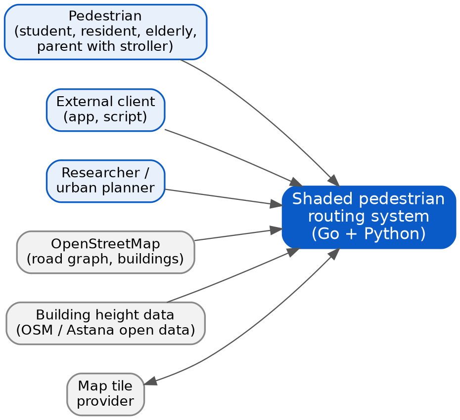
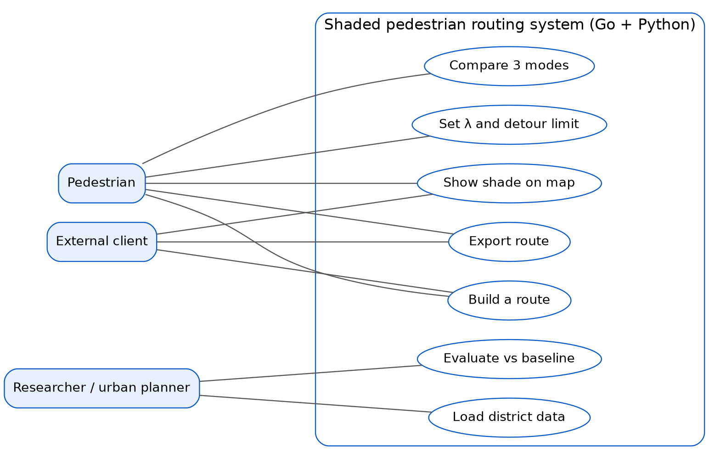
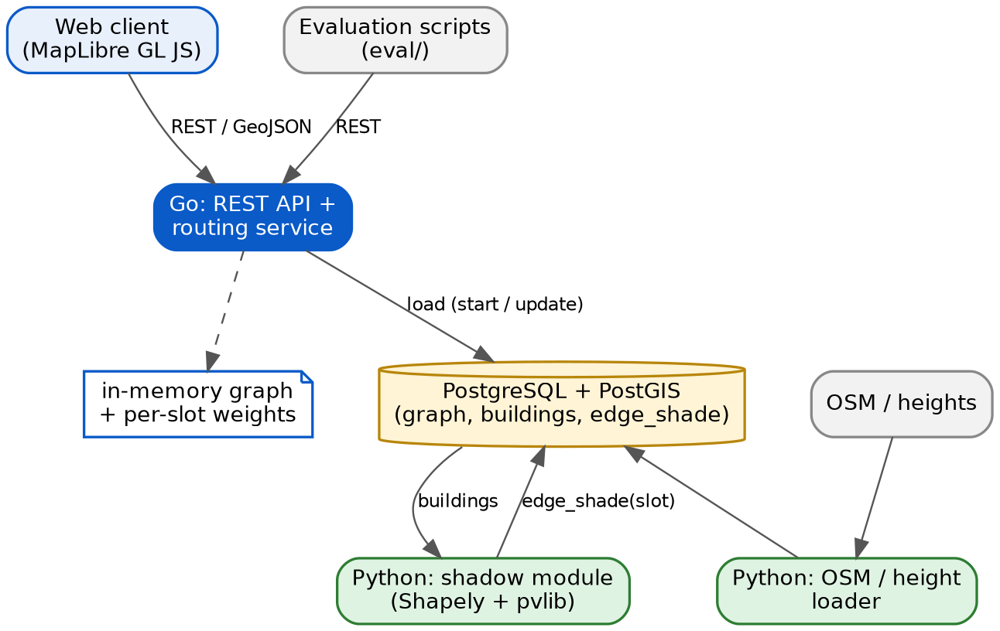

# Architecture and diagrams

Three diagrams are kept consistent: context -> use cases -> the components that implement those use cases.
Editable sources: `docs/diagrams/source/`.

## 7.1 System context
The system is a black box with three kinds of neighbours: users (pedestrian, external client, researcher), a mandatory data source (OpenStreetMap)
and optional ones (building-height data, map tile provider).

## 7.2 Use cases
| Use case | Requirements | Actor |
|---|---|---|
| Build a route | FR-1, FR-3, FR-4, FR-5 | Pedestrian, external client |
| Set lambda and detour limit | FR-3, FR-7 | Pedestrian |
| Compare 3 modes | FR-4 | Pedestrian |
| Show shade on the map | FR-2, FR-5 | Pedestrian, external client |
| Export route | FR-8 | Pedestrian |
| Load district data | NFR-3, NFR-4, NFR-5 | Researcher |
| Evaluate against baseline | `09-verification-plan.md` | Researcher |

## 7.3 Components (draft)

**Request flow.** The Python loader puts the pedestrian graph and buildings into PostGIS -> the Python shadow module computes the sun fraction s(e,t)
per time slot and writes `edge_shade` -> the Go service loads the graph and weights into memory at start -> the client sends points, date/time and lambda ->
Go runs Dijkstra/A* with w(e,t) and returns GeoJSON. The evaluation scripts call the same API, so the baseline (lambda = 0) and the shaded route are computed on identical data.

This is a draft: service boundaries and table names are refined after the shadow-computation prototype (milestone M-B).
