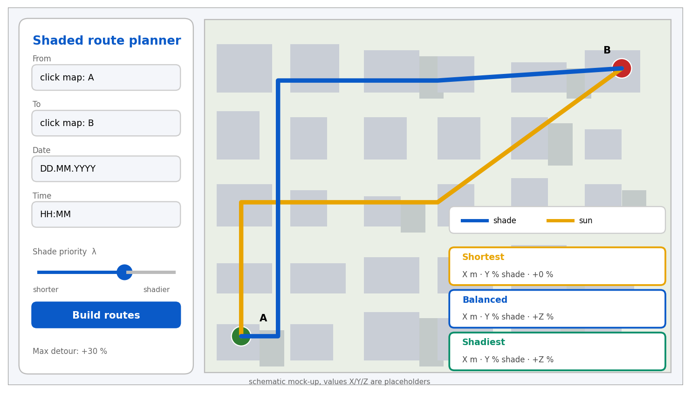

# UX and prototype

The user selects two points on the map, a date, a time and uses a slider for the importance of shade; an external client does the same with one POST request.
The mock-up is schematic: values X, Y, Z and the JSON below are placeholders that show the format.



## Key scenarios
1. **Build a shaded route.** Click start and destination -> "Build routes" -> three variants with length, shade share and detour -> highlight the chosen one (FR-1, FR-3 to FR-5).
2. **Find a compromise.** The lambda slider and the detour limit change the route without a page reload (FR-3, FR-7).
3. **See shade at another time.** Changing the time recolours the shade/sun segments (FR-1, FR-2, FR-5).

## API examples
`POST /route`
```json
{
  "from": {"lat": 0.0, "lon": 0.0},
  "to":   {"lat": 0.0, "lon": 0.0},
  "datetime": "2026-07-15T15:00:00+05:00",
  "lambda": 0.7,
  "max_detour_pct": 30
}
```
Response: a GeoJSON `FeatureCollection` with three features (`shortest`, `balanced`, `shadiest`); `properties` contain `length_m`, `shaded_share`, `detour_pct`.

Other calls: `GET /shade?bbox=...&datetime=...` (sun fraction on edges in the map window, scenario 3) and `GET /health` (service state and data version).
Errors: HTTP 422 for validation (with field and reason); HTTP 404 for a point outside coverage (with the coverage bounds).

The prototype will be checked in the 5-user test (SUS, NFR-8; see `09-verification-plan.md`).
